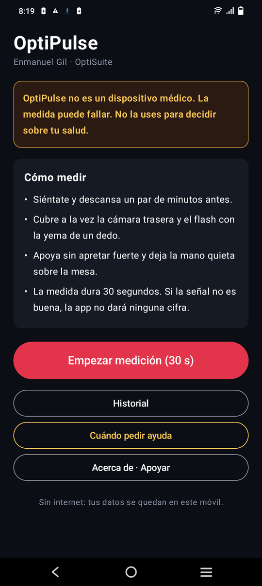
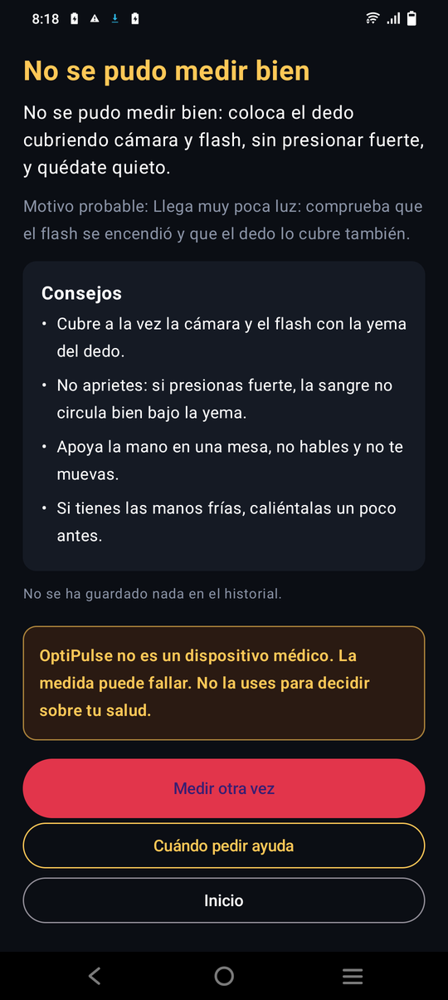
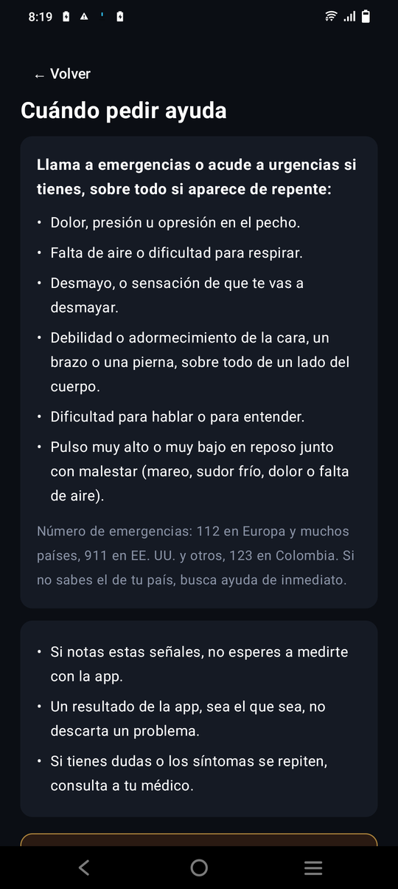

# OptiPulse

**Mide tu pulso con la cámara del móvil — y te dice la verdad cuando no puede medirlo.**

Gratis · Android 8+ · Sin internet · Sin anuncios

**Descarga:** [OptiPulse.apk](https://github.com/EnMaNueL-G/optipulse/releases/latest/download/OptiPulse.apk)

> ⚠️ **OptiPulse no es un dispositivo médico.** La medida puede fallar. No la uses para decidir sobre tu salud. Si tienes dolor u opresión en el pecho, falta de aire, desmayo, debilidad o adormecimiento de la cara o de un brazo, o dificultad para hablar: **llama a emergencias**.

## Cómo funciona

Cubre con la yema del dedo la cámara trasera y el flash durante 30 segundos. Con cada latido cambia un poco la cantidad de sangre bajo la piel y, con ella, el color que ve la cámara. OptiPulse mide ese cambio y calcula tus pulsaciones por minuto.

## Honesta por diseño

- **Si la señal no es buena, no da ninguna cifra**: te dice «No se pudo medir bien» y por qué (dedo mal puesto, poca luz, movimiento…).
- El resultado va con su **margen** («≈ 72 lpm, ± 3») y la **calidad** de la señal.
- Calcula el pulso de dos formas independientes y solo lo muestra si coinciden.
- No interpreta tu resultado ni diagnostica nada.
- Probada con miles de señales simuladas (45–200 lpm, con ruido y movimiento) y con medidas reales comparadas con el pulso tomado a mano. No está validada frente a un equipo médico.

## Privacidad

Sin permiso de internet: tus medidas se quedan en tu móvil. El historial no se copia a la nube y lo puedes borrar cuando quieras. Solo pide la cámara, y la usa solo mientras mides.

## Instalar

Descarga `OptiPulse.apk` y ábrelo; Android te pedirá permitir instalar apps de este origen. **Si tenías la versión 1.0, desinstálala antes** (esta se firma con otra clave).

## Apoya el proyecto

- **Binance Pay ID:** `1165745950`
- **USDT (BSC · BEP-20):** `0xb6f6731a4ea87f8e1fd6f44f48b5bc4204571f08`

© 2026 Enmanuel Gil · OptiSuite — [optisuite.app](https://optisuite.app)
